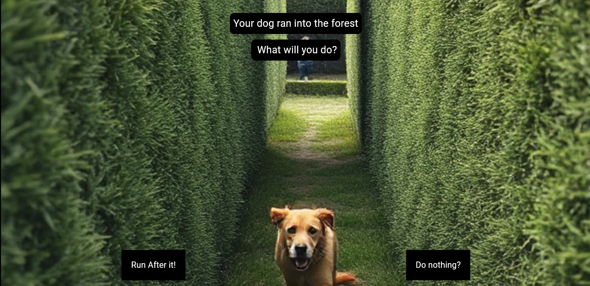
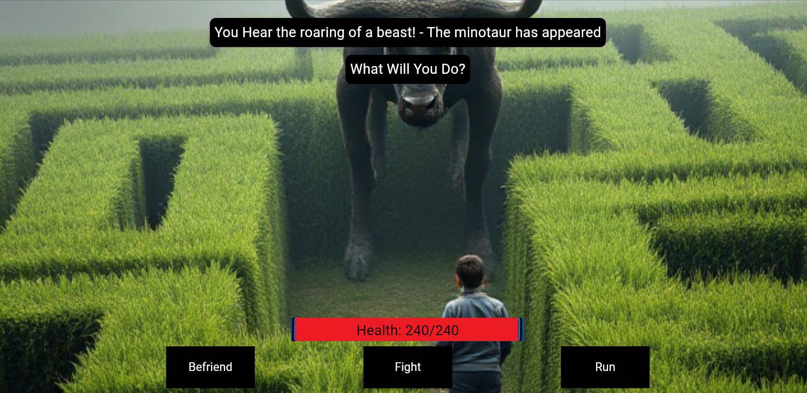
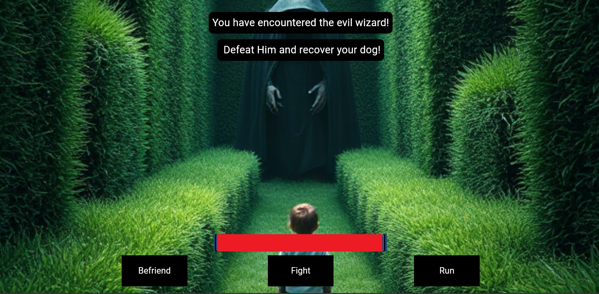
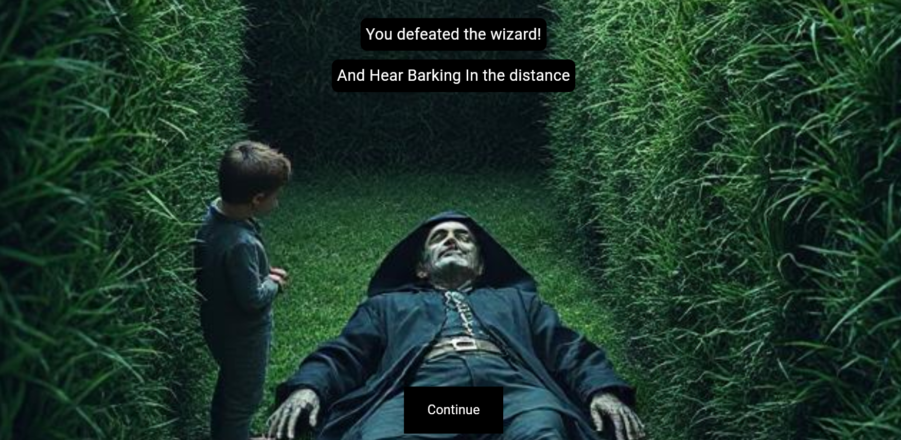

Interactive Story Application:

A brancing adventure game I created using Flutter and Dart. The story follows a character whose dog has entered a forst. The player has to make choices, encounter enemies and find their dog to complete the game.

Screenshots:
## 1. Starting the adventure

## 2. Encountering the Minotaur

## 3. Encountering the Wizard

## 4. Defeating the Wizard

## 5. Completing the Game

Features:
- Make choices that affect how the story progresses
- Choose to befiend, fight or run from enemies
- Health indicators during encounters
- Story events withd ifferetn images and audio
- Story data loaded from CSV files

Technologies Used:
- Dart and Flutter
- Hive for local data storage
- CSV for story data
- Audiplayers for audio

What I learned:
Through this project, I gained experience working with classes, loading data from CSV files, storing and retrieving data using Hive, and handling user choices in Flutter. I also worked with images and audio to make the game more interactive. 
